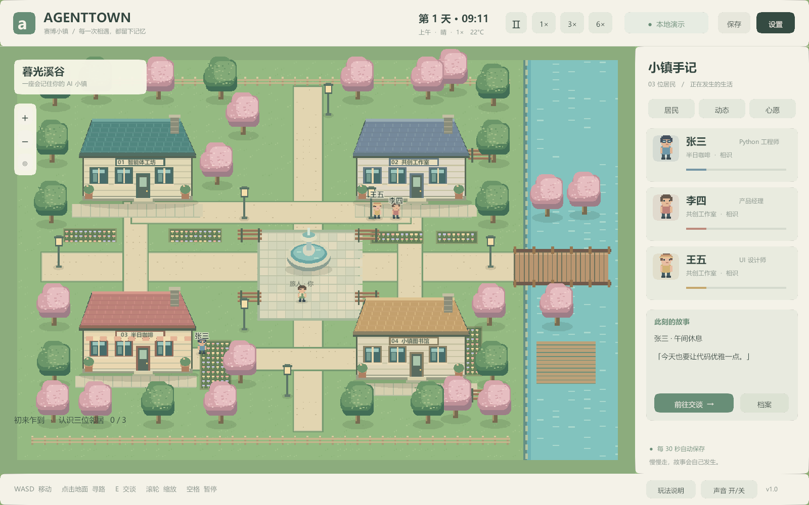

# AgentTown

[简体中文](README.zh-CN.md) · [Windows releases](https://github.com/OrangefishZeyu/AgentTown/releases)

AgentTown is a single-player pixel-art town built in Unity 6. Walk to the workshop, introduce yourself to its engineer, then come back later and ask what he remembers. Each of the three residents keeps a separate conversation history and follows a daily schedule.

## Play

On Windows, download the game ZIP from Releases when available, extract the entire folder, and open **AgentTown.exe**. The offline demo uses local dialogue rules. Open **Settings (设置)** and select **English** to switch languages. Move with WASD, click the ground to find a path, and press **E** near a resident to talk. Progress saves automatically after conversations and every 30 seconds. **Settings → New game** archives the current save and starts a fresh set of memories.

## How the town works

| System | Implementation |
| --- | --- |
| World simulation | Unity C# controls the clock, daily routines, A* walking paths and encounters. |
| Conversations | A local Python service sends the resident’s role, activity, relationship and conversation context to a compatible chat model. |
| Memory | SQLite stores exchanges by player and resident. The backend retrieves up to five relevant memories using word overlap, importance and recency, alongside the last ten turns. |
| Presentation | The client renders the pixel-art town and supports English and Chinese. Previous conversations retain their original text. |

## Run from source

1. Open the repository root with **Unity 6000.6.8f1**.
2. Open **Assets/Scenes/AgentTown.unity** and press **Play**.
3. For optional model-generated dialogue, install Python 3.10 or newer. From the repository root in PowerShell, run the commands below. Put your own provider key in the local configuration file before starting the service.

~~~powershell
Copy-Item Backend/.env.example Backend/.env
notepad Backend/.env
python Backend/server.py
~~~

The template uses Qwen3.7-Flash. Select **Settings → AI backend** in the game and keep the local address at **http://127.0.0.1:8000**. The backend uses the Python standard library. Run its tests with `python -m unittest discover -s Backend -v`.

## Project layout

- [Unity runtime](Assets/AgentTown/Runtime) contains simulation, navigation, UI, language selection and saves.
- [Python backend](Backend) contains the chat service, memory retrieval and tests.
- [Editor tools](Assets/AgentTown/Editor) include scene setup, validation and the Windows build command.
- [Validation notes](Docs/VALIDATION.md) describe tested behavior and known limitations.

## Credits and license

This Unity adaptation draws on Datawhale’s [Hello-agents AI Town](https://github.com/datawhalechina/hello-agents/tree/main/code/chapter15/Helloagents-AI-Town). The Unity client and Python backend were implemented for this project. The educational adaptation uses [CC BY-NC-SA 4.0](LICENSE.md). Unity and its packages have their own license terms.
