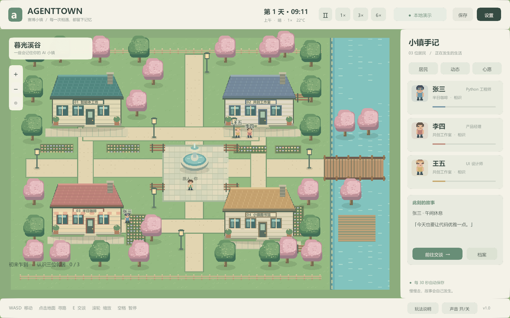

# AgentTown · 赛博小镇（Unity 版）

[English](README.md) · [Windows 下载](https://github.com/OrangefishZeyu/AgentTown/releases)

一座会记住你的小镇。基于 **Unity 6 / 2D URP**，将 Hello-agents 第十五章的 NPC 对话、记忆与好感度玩法迁移到 Unity，并扩展为可以散步、探索、观察居民日常的原创像素小镇。



## 直接开始

1. 用 **Unity 6000.6.8f1** 打开当前整个文件夹。
2. 打开 `Assets/Scenes/AgentTown.unity`，或使用菜单 **AgentTown → 1 · 打开小镇场景**。
3. 点击 **Play**。默认就是可离线游玩的本地演示，无需 API Key、Python 或额外付费素材。
4. 如果 Game 面板太小，将鼠标放在 Game 面板上，按 **Shift + Space** 放大。

Unity 打开时会自动生成缺失的入口场景；`SampleScene` 保留为原始模板。场景在编辑器中显示地图预览，角色、界面与模拟系统在 Play 时生成。

## 已实现

- **原创像素场景**：四座建筑、喷泉广场、河流、木桥、樱树、花圃、长椅与路灯；14 张图片可直接在 Unity 中使用。
- **四向角色动画**：玩家和三位居民，每位包含四个方向、四帧走路动作，按纵坐标遮挡排序。
- **自由行走 / 自动寻路**：键盘移动、点击地面 A* 寻路、障碍检测、点击居民自动走近交谈。
- **居民日程**：早餐、工作、午休、创作、广场散步、晚间社交与休息；支持暂停及 1 / 3 / 6 倍时间。
- **生活动态**：居民头顶想法、偶遇交流、时间线、心情和精力、昼夜色调。
- **中文对话**：输入文本、快捷话题、对话滚动、处理中状态、错误时明确提示并回退本地演示。
- **独立记忆**：每位居民有自己的对话记录，支持记住玩家姓名和喜好；档案可查看记忆及来源。
- **五级关系**：陌生、相识、友好、亲密、挚友；友好与不友好表达带来不同变化。
- **三项心愿**：认识所有居民、探索四座建筑、获得第一段友谊。
- **自动存档**：每 30 秒、对话完成、关闭游戏时保存；临时文件写入并保留上一次备份。
- **设置界面**：本地 / 后端模式、地址、连接检测、音乐切换；内置轻柔的程序生成音乐。
- **本地 AI 后端**：Python 标准库 HTTP 服务、SQLite 长期记忆、检索相关历史、兼容 OpenAI 格式的模型 API。
- **验证入口**：核心系统校验、运行烟雾测试、后端单元测试、Windows 构建菜单。

## 操作

### 语言与存档

游戏设置底部可切换 `中文 / English`。切换会保存进度并重新载入场景，界面和新生成的 AI 回复随语言切换，已有对话保留原文。后端更新后需要重启。

默认自动继续上次存档：每 30 秒、对话结束和退出时保存。设置底部的「重新开始 / New game」需要再次确认；旧的 `town-save.json` 和 `preferences.json` 会复制到存档目录下的 `Archives` 子目录，然后创建新进度和新的玩家 ID。后端旧记忆仍保留，但不会被新玩家 ID 读取。恢复某个归档时先退出游戏，再将其中两个 JSON 文件一同复制回存档目录。

Windows 存档目录通常为 `%USERPROFILE%/AppData/LocalLow/AgentTown/AgentTown`；游戏设置显示实际路径，也可用 Unity 菜单 `AgentTown → 6 · 打开存档目录`。

### 导出独立程序

Unity 菜单 `AgentTown → 4 · 构建 Windows 成品` 导出到 `Builds/AgentTown`。成功后运行 `AgentTown.exe` 即可，不需要 Unity 编辑器；分发时要保留整个输出目录，不能只复制 exe。AI 功能仍需运行 Python 后端。本机可沿用现有后端；对外分发需要由用户配置自己的后端，或部署统一的服务端。不要把开发者的 `.env` 和 API Key 放入发布包。

本机此前遇到 Windows 应用程序控制策略阻止 `PlayerBuildProgramLibrary.dll`（0x800711C7）。若再次出现，需要在允许 Unity 正常构建的环境中导出；没有关闭系统安全策略。

| 操作 | 按键 |
|---|---|
| 移动 | WASD / 方向键 |
| 自动寻路 | 点击地面 |
| 走近居民交谈 | 点击居民 / 右侧「前往交谈」 |
| 附近交谈 | E |
| 缩放 | 滚轮 / 左侧 +、− |
| 恢复总览 | 左侧 ◎ |
| 暂停 / 继续日程和时钟 | 空格 |
| 保存 | F5 / 顶部「保存」 |
| 关闭当前界面 | Esc |

暂停时仍然可以控制玩家。放大后镜头跟随玩家。正在输入或打开弹窗时，游戏移动快捷键不会抢走输入。

## 三位居民

| 居民 | 职业 | 性格和关注点 |
|---|---|---|
| 张三 | Python 工程师 | 安静专注，研究开源与多智能体系统 |
| 李四 | 产品经理 | 外向热情，关心社区与大家的需求 |
| 王五 | UI 设计师 | 细腻温柔，喜欢配色、光影和咖啡 |

可以先发送「你好，我叫小林，喜欢咖啡」，再问「你记得我喜欢什么吗？」。关闭游戏后再来，记录仍然保留。

## 接入真正的 AI

**本地演示是内置规则对话；真正的自由语言生成需要你自己的模型服务。** NPC 的日程、移动和偶遇由 Unity 本地模拟控制。

1. 将 `Backend/.env.example` 复制为 `Backend/.env`。
2. 配置：

```dotenv
LLM_API_KEY=你的密钥
LLM_BASE_URL=https://maas.qianwenaiapi.com/compatible-mode/v1
LLM_MODEL=qwen3.7-flash
LLM_ENABLE_THINKING=false
```

3. 双击根目录 **启动AI后端.bat**，或在 Python 3.10+ 下执行：

```powershell
cd Backend
python server.py
```

无需 `pip install`。启动脚本优先查找系统 Python，也兼容本机 Codex 捆绑的 Python 运行时。没有可用 Python 时会显示提示。

4. 游戏中打开「设置」，地址保留 `http://127.0.0.1:8000`，点击「AI 后端」及「测试连接」。顶部显示 **AI 已连接**。
5. 空 Key 时后端可启动，但界面显示 **后端演示**。网络或模型错误会回退并标记为 **本地演示**，不会把演示内容冒充 AI。

当前配置对应千问平台的按量付费 OpenAI 兼容接口。Qwen3.7-Flash 默认开启思考；这里关闭思考，适合简短 NPC 对话。切换其他服务时，请核对该平台的地址和模型名称；不支持思考参数的服务需将 `LLM_ENABLE_THINKING` 留空。

连接检测只检查本地后端，不代表模型密钥已经验证。在 Backend 目录执行 `python server.py --check-provider` 可发送一次真实模型请求（按平台计费），成功后显示 `Provider verified`。这次检查不会写入 NPC 对话和记忆。修改 `.env` 后须重启后端；同名系统环境变量会优先于 `.env`。不要将 `.env` 提交到 GitHub。

模型接收：角色设定、当前活动、游戏时间、关系、最近 10 轮对话及最相关的 5 条长期记忆。长期检索采用中文双字词 / 英文词匹配、重要性和时间权重，不依赖外部向量数据库或 HelloAgents Python 包。后端记录按玩家 ID 和 NPC 分隔。

## 目录

```text
Assets/AgentTown/
  Runtime/
    TownGame.cs          # 模拟时钟、输入、日程、社交、对话、存档、运行验证
    TownUI.cs            # 中文 HUD、居民、动态、心愿、对话、档案、设置
    TownWorld.cs         # 地图组装与遮挡
    TownActor.cs         # 角色移动与四向动画
    TownNavigation.cs    # 半单位网格与 A* 寻路
    TownData.cs          # 数据模型、配置和存档
  Editor/TownProject.cs # 场景生成、纹理导入、校验、构建
  Resources/Town/       # 原创像素 PNG 素材
Assets/Scenes/AgentTown.unity
Backend/
  server.py              # 本地 HTTP / SQLite / 模型服务
  test_server.py         # 后端测试
  .env.example
Tools/generate_art.py    # 可复现的原创素材生成器（重生成需 Pillow）
```

地图采用 1536 × 1024 设计坐标，32 像素对应 1 Unity 单位。布局、建筑碰撞和居民目的地集中在 `TownWorld.cs`、`TownGame.cs` 中，可直接扩展。

## 存档与后端数据

- 游戏：`%USERPROFILE%/AppData/LocalLow/AgentTown/AgentTown/`
- `town-save.json`：时间、位置、好感、对话与心愿；`.bak` 为上一次备份。
- `preferences.json`：后端地址、模式、声音和本地生成的玩家 ID。
- 后端：`Backend/data/town.sqlite3` 和滚动 `dialogue.jsonl` 日志。
- 游戏和后端分别保存记录；切换模式前在演示中产生的旧对话不会自动导入后端。AI 只能回忆其后端已有的历史。
- AI 请求中将发送玩家消息和相关角色上下文给你配置的模型服务。Key 始终只在后端。

## 校验与构建

Unity 菜单 **AgentTown → 3 · 校验核心系统** 会检查四座建筑及桥的路径、路径障碍、演示记忆回忆、好感变化和存档序列化。

**AgentTown → 5 · 运行流程烟雾测试** 会用隔离的演示状态自动走向居民、连续聊两轮并验证回忆。结果和截图保存在 `Builds/QA/`，不会覆盖玩家存档。

后端测试：

```powershell
python -m unittest discover -s Backend -v
```

Windows 构建：**AgentTown → 4 · 构建 Windows 成品**，成功时输出 `Builds/AgentTown/AgentTown.exe`，之后可用「启动小镇.bat」打开。

命令行构建（先关闭使用同一工程的 Unity 编辑器）：

```powershell
Unity.exe -batchmode -quit -projectPath "工程绝对路径" -executeMethod AgentTown.Editor.TownProject.BuildWindows -logFile "构建日志路径"
```

本机首次打包时 Windows 应用程序控制策略阻止了 Unity 安装目录中的 `PlayerBuildProgramLibrary.dll`（错误 0x800711C7）。这会阻止导出 exe，编辑器内 Play 不依赖该打包步骤。未修改系统安全设置。实际验证结果见 `Docs/VALIDATION.md`。

## 当前范围

这是可以在 Unity 内运行的完整核心玩法版本。建筑作为室外地标与日程目的地；尚未制作可进入的室内地图、多人联机、语音对话或移动端触控。中文字体优先使用 Windows 微软雅黑；要发布其他平台，建议自行加入具备相应授权的中文字体资源。

## 来源与署名

灵感和教学基线来自 Datawhale 的 [Hello-agents 第十五章：构建赛博小镇](https://github.com/datawhalechina/hello-agents/blob/main/docs/chapter15/第十五章%20构建赛博小镇.md) 与 [Helloagents-AI-Town](https://github.com/datawhalechina/hello-agents/tree/main/code/chapter15/Helloagents-AI-Town)。保留张三 / 李四 / 王五三位职业角色的教学设计。

原项目使用 Godot + FastAPI + HelloAgents；本项目重新编写 Unity C# 前端与轻量 Python 后端，地图、角色素材和音乐均为本工程原创生成。没有复制原项目的 Godot 场景或第三方像素素材。

上游标注 **CC BY-NC-SA 4.0**。本次教学改编也按该许可提供，详见 `LICENSE.md`。Unity 引擎和 Package Manager 依赖分别适用各自许可。

